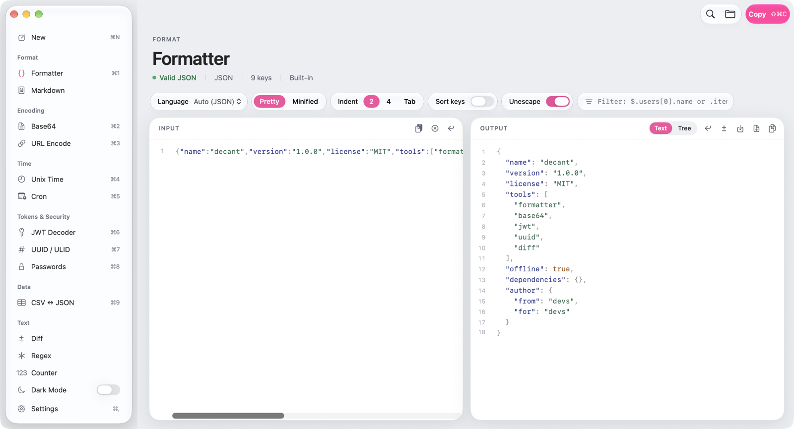
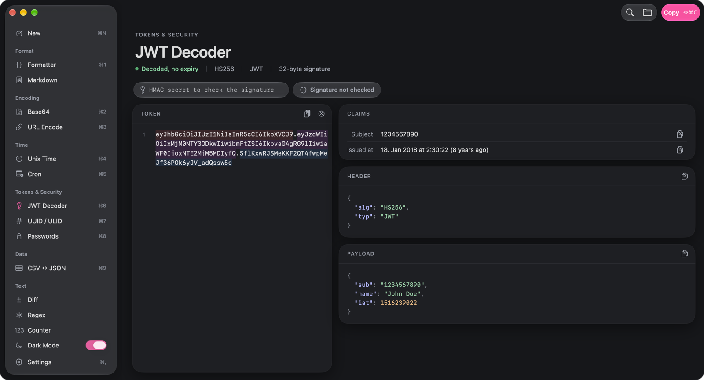

# Decant

Paste anything; Decant detects the format and converts it — plus a set of focused developer tools. Native macOS app (SwiftUI + AppKit, macOS 14+). Everything runs locally.

Decant is open source and free — forever. No accounts, no telemetry, no network calls except the daily update check against GitHub releases (turn it off in Settings → General), no paid tier, no "pro" features.




## Install

Download `Decant-<version>.zip` from [Releases](https://github.com/techtheoryio/decant/releases), unzip, and move `Decant.app` to Applications. Builds are signed and notarized. Updates come through [Sparkle](https://sparkle-project.org): Decant checks the latest GitHub release once a day and installs new versions automatically (Decant → Check for Updates… to check now; both settings are in Settings → General).

Or build it yourself (needs Xcode 26 / Swift 6):

```bash
git clone https://github.com/techtheoryio/decant.git && cd decant
scripts/build-app.sh 0.0.0 && open .build/Decant.app
```

For development:

```bash
swift run Decant      # build and launch
swift test            # engine tests
```

## Tools

| Category | Tools |
| --- | --- |
| Format | Auto Detect (New), Formatter (JSON tree/query/repair; JS, TS, CSS, SCSS, Less, HTML, XML, Markdown, YAML, GraphQL), Markdown preview, OpenAPI editor with a [Scalar](https://github.com/scalar/scalar) API reference preview |
| Encoding | Base64 (text and files, URL-safe, padding, MIME wrap, data: URIs, magic-byte detection), URL encode with query table |
| Time | Unix time (live clock, results table, date picker, time zones, differences), Cron (plain words, next runs) |
| Tokens & Security | JWT decoder with HMAC check, UUID v4/v7 + ULID generator and inspector, password generator |
| Data | CSV ↔ JSON with table preview, JSON ↔ YAML (YAML 1.2, anchors and merges) |
| Text | Diff (side by side / unified, word highlights, folding), Git Diff cleanup for AI review (drops lockfiles, generated and binary files; path filters), Regex tester, character/word/line counter |
| Miscellaneous | Color converter (color panel, eyedropper, contrast), QR code generator and reader |

Shortcuts: ⌘K command palette, ⌘1–⌘9 tools (order from Settings → Sidebar), ⌘N new document, ⌘O open file, ⌘S save output, ⇧⌘C copy output, ⌘F find in output, ⌘+ / ⌘− font size, ⌥⌘Z wrap lines.

## Staying small

Decant's main feature is what it leaves out. Every tool has to earn its place, and the bar is high:

- **Daily use.** A tool belongs here if developers reach for it every week, not once a year.
- **Offline and local.** Nothing leaves your machine. No features that need a server, an API key, or a login.
- **Almost no dependencies.** Apple's frameworks plus [Sparkle](https://sparkle-project.org) for updates. Optional external tools (Biome, Prettier) are used when you already have them, never bundled. The OpenAPI preview ships Scalar's prebuilt script so it works offline.
- **Fast to open, fast to use.** Paste, get the answer, move on. No setup, no onboarding, no settings you have to learn first.
- **Deleting beats adding.** A smaller, sharper app is better than a bigger one. We remove things that don't pull their weight.

If an idea doesn't fit, that's not a judgment on the idea — it probably makes a great standalone tool.

## Contributing

Bug fixes, polish, and better behavior of existing tools are always welcome — just open a PR.

For a **new tool or a bigger change, open an issue first** so we can talk about whether it fits the list above before you spend time on it.

Ground rules for PRs:

- Keep the diff focused. One change per PR.
- No new dependencies (Sparkle for updates is the only one).
- Logic goes in `Sources/DecantCore` with a test in `Tests/DecantCoreTests`; `swift test` must pass.
- Match the surrounding code style. Less code is better code.

## Notes

- `Sources/DecantCore` — deterministic engine and tool logic, no UI. `Sources/Decant` — the app.
- History lives in `~/Library/Application Support/Decant/history.json`; retention and size are set in Settings → History. Pinned entries are kept.
- The Formatter uses Biome or Prettier when either is on your login-shell `PATH` (looked up via `zsh -lic`), Biome first for the languages it supports. Without them it falls back to the built-in JSON and JS/TS formatters and Foundation's XML/HTML pretty-printer; other languages are shown unformatted.
- OpenAPI preview: `Sources/Decant/Resources/scalar.js` is the standalone build of [`@scalar/api-reference`](https://www.npmjs.com/package/@scalar/api-reference) (MIT), currently 1.73.1. To update, replace it with `https://cdn.jsdelivr.net/npm/@scalar/api-reference@<version>/dist/browser/standalone.js`. Telemetry, the AI agent, MCP and web fonts are turned off in `ScalarView`; "Test Request" still sends requests to the API's servers when you click it.
- App icon: source `Assets/AppIcon.svg`; after editing run `Assets/make-icon.sh` (needs `rsvg-convert`) to rebuild `Sources/Decant/Resources/AppIcon.icns`.
- Releasing: push a `v1.2.0`-style tag; `.github/workflows/release.yaml` runs the tests, builds a universal `.app` with `scripts/build-app.sh`, signs and notarizes it, and attaches the zip to a GitHub release. It also signs the zip with Sparkle's EdDSA key and attaches an `appcast.xml`; the app's feed URL is `releases/latest/download/appcast.xml`. Secrets: `DEVELOPER_ID_P12` (base64 `.p12`), `DEVELOPER_ID_P12_PASSWORD`, `NOTARY_KEY` (base64 App Store Connect `.p8`), `NOTARY_KEY_ID`, `NOTARY_ISSUER_ID`, `SPARKLE_ED_KEY` (`.build/artifacts/sparkle/Sparkle/bin/generate_keys --account decant -x key.txt`; the public key is in `scripts/build-app.sh`).
- Debug builds: `[DECANT_TOOL=base64] DECANT_INPUT=… [DECANT_AUX=…] DECANT_SNAPSHOT=out.png [DECANT_DARK=1] .build/debug/Decant` writes a PNG of the window and quits without touching history. UserDefaults can be set per run with launch arguments, e.g. `-formatterTree YES`.

## License

[MIT](LICENSE).
